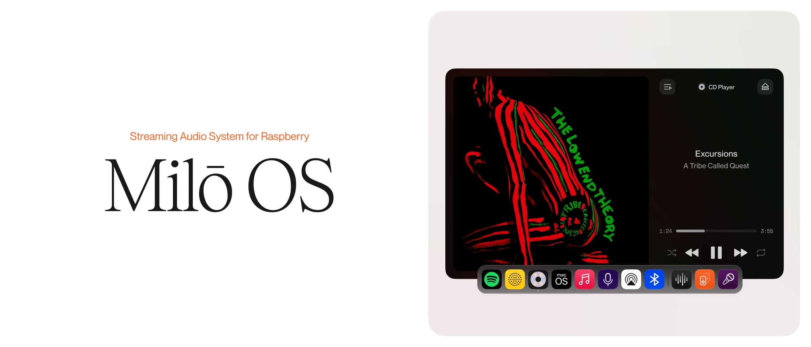
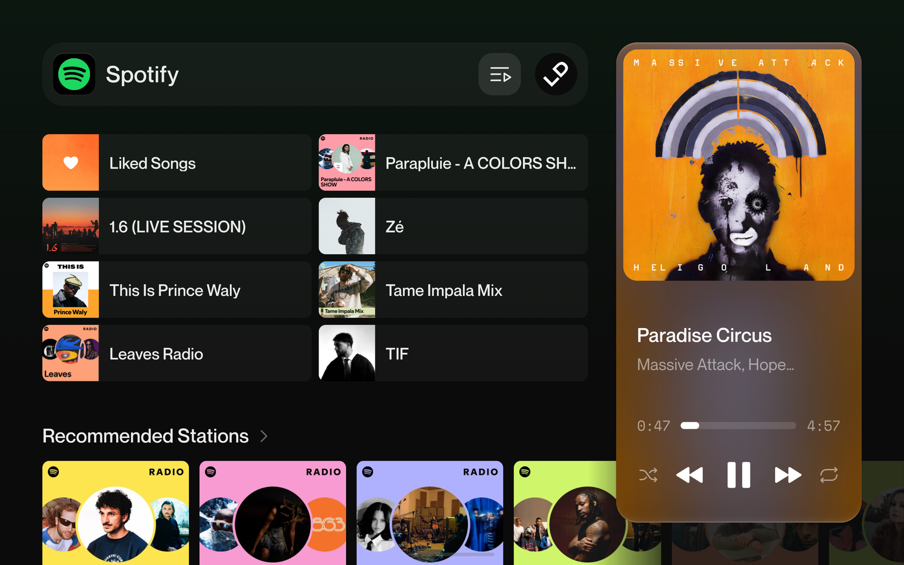
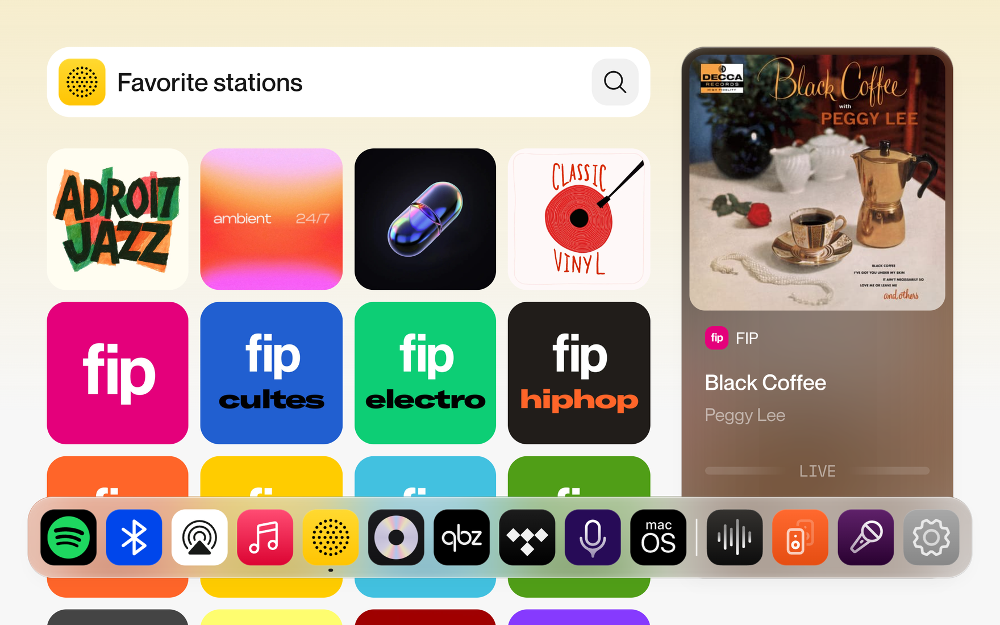
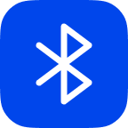
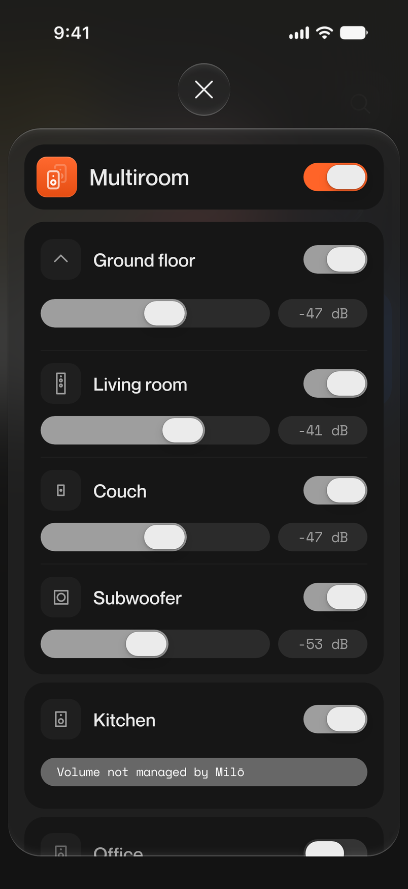
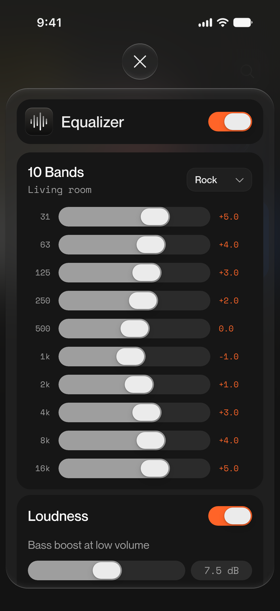
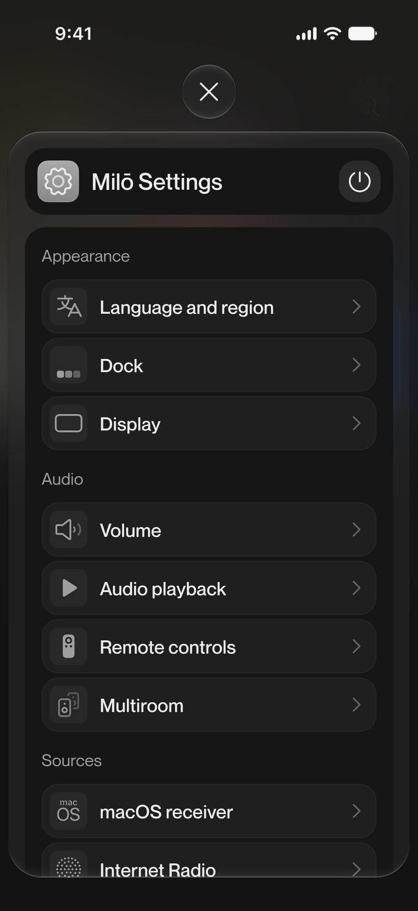
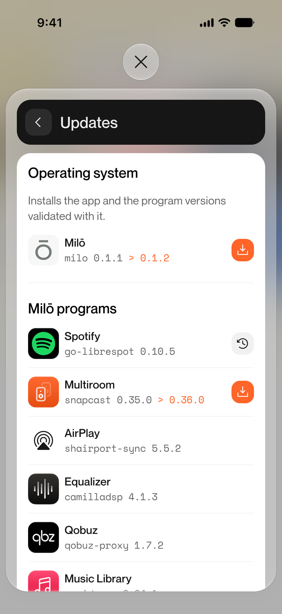

  

# Milō OS

### Turns a Raspberry Pi and an audio board into a complete music system.

Play Spotify, Qobuz, TIDAL, AirPlay, Bluetooth, internet radio, podcasts, CDs and your own
music library, all from one interface on its touchscreen, your phone and your Mac. Add a
Raspberry Pi per room and every room plays in sync, each with its own volume and equalizer.
It installs from a single image, and a setup wizard takes care of the rest, with no terminal
step.

📖 **[Documentation](https://milo-audio.com/docs)**: hardware, installation, every source and every setting.

## Audio sources

  
  

&nbsp;&nbsp;**Spotify Connect**, with your library, playlists and profiles

&nbsp;&nbsp;**Qobuz Connect**, lossless

&nbsp;&nbsp;**TIDAL Connect**

&nbsp;&nbsp;**AirPlay 2**, from an iPhone, iPad or Mac

&nbsp;&nbsp;**Bluetooth**, from any phone

&nbsp;&nbsp;**Internet radio**, 50,000+ stations, with favorites and track recognition by Shazam

&nbsp;&nbsp;**Podcasts**, search, subscribe and resume where you left off

&nbsp;&nbsp;**CD player**, with track and album lookup

&nbsp;&nbsp;**Music library**, your own files from a USB drive or a network share (SMB, NFS)

&nbsp;&nbsp;**Your Mac's sound**, with low latency, through [Milō Mac](https://github.com/leodurandfr/Milo-Mac)

Milō is an independent project, not affiliated with or endorsed by Spotify, Apple, TIDAL,
Qobuz or Shazam, and its integrations with them are unofficial: Spotify Connect runs on
[go-librespot](https://github.com/devgianlu/go-librespot), AirPlay on
[shairport-sync](https://github.com/mikebrady/shairport-sync) and Qobuz Connect on
[qobuz-proxy](https://github.com/leolobato/qobuz-proxy), three open-source reimplementations;
TIDAL Connect runs Tidal's own daemon with another manufacturer's device certificate, from a
community-published image a unit downloads the first time TIDAL is selected; track recognition calls Shazam through
[shazamio](https://github.com/shazamio/ShazamIO). A service can change in a way that stops one
of them working until the program behind it catches up. The names and logos of these services
are their owners' trademarks.

## Features

  

  
  
  
  

- **Multiroom**: every room on the same song, in sync. An extra Raspberry Pi finds your Milō
  and joins it as a speaker on its own. Zones group rooms, each speaker keeps its own volume,
  and a subwoofer gets the low end automatically.
- **Equalizer**: 10 bands, 22 presets, a compressor and loudness compensation, on every
  speaker separately (CamillaDSP).
- **Lyrics**: synced line by line with the track, on Spotify, Qobuz, TIDAL, AirPlay, your
  library, a CD, or the radio once the song is recognized.
- **Light and dark themes**, or Auto, which turns dark from sunset to sunrise. The screenshots
  on this page show both.
- **Updates**: one press updates Milō and every multiroom speaker. The programs behind the
  sources (Spotify Connect, AirPlay, Qobuz Connect, the music library), multiroom and the
  equalizer update the same way, each to the version tested with Milō.
- **8 languages**: English, French, German, Spanish, Portuguese, Italian, Chinese, Hindi.

## Hardware

- **Raspberry Pi 5** recommended for the main unit; a Raspberry Pi 4 or 5 for a multiroom
  speaker. The Raspberry Pi 3 and earlier models are not supported: Milō is developed and
  tested on the Pi 4 and Pi 5 only. How much memory each role needs has not been measured yet.
- **A HiFiBerry board, on every unit**: Milō plays through it alone, not through HDMI or a USB
  DAC, and does not set up without one. The supported boards are the ones the setup wizard
  offers: an amplifier for passive speakers (Amp2, Amp4, Amp4 Pro, Amp100) or a DAC for an
  amplifier you already own (DAC2 HD, DAC2 Pro or DAC+ Pro, DAC2 ADC Pro). Any other board is
  untested and cannot be picked. With a screen, the Amp4 Pro is the only amplifier that can
  power it.
- **Optional**: a Waveshare touchscreen (7" USB or 8" DSI), a volume knob, an Apple Remote or a
  Bluetooth remote, a USB CD drive.

Parts list and wiring: [Required hardware](https://milo-audio.com/docs/quick-start/hardware).
Every board, screen and default GPIO pin the code supports, generated from it:
[Supported hardware](docs/reference/hardware.md).

## Installation

1. Download the latest `.img.xz` from [Releases](https://github.com/leodurandfr/Milo/releases).
2. Write it to a microSD card (32 GB or more) with
   [Raspberry Pi Imager](https://www.raspberrypi.com/software/) ("Use custom"). If Imager asks
   whether to apply "OS customisation" settings, choose **No**: Milō sets up its own Wi-Fi in its
   setup wizard, and a user name, hostname or SSH setting applied by Imager stops it from
   working or opens it to the network.
3. Insert the card and power the Raspberry Pi on.
4. Reach the setup wizard:
   - **with an Ethernet cable** (recommended), open **http://milo.local** from a phone or
     computer on the same network;
   - **without a cable**, join the open **Milō** Wi-Fi network, and the setup page opens on its
     own. That network is open, so the Wi-Fi password you type there crosses it unencrypted.
5. Follow the wizard, then Milō restarts, ready to play.

**If http://milo.local does not open**, the device you are on may not resolve `.local` names:
some Android phones and some Windows computers do not, nor does a device on a VPN or on a guest
network kept apart from the rest. Look for `milo` in your router's list of connected devices and
open the address shown there, `http://` followed by that address; with a screen, Settings ›
Network on Milō shows it too.

**Multiroom speakers** use the same image, and your Milō turns each one into a speaker. New
speakers appear in Settings › Multiroom on the main unit once multiroom is turned on there.
Power the new speaker on:

- **with an Ethernet cable**, it finds your Milō on its first boot (the main unit announces
  itself on the network as a Milō, `_milo._tcp`), becomes its speaker and restarts; it then
  appears in Settings › Multiroom, where you pick its audio card and its name;
- **without a cable**, it raises the same open **Milō** Wi-Fi network as a fresh main unit.
  Do not join it to run the wizard, which would make it a second main unit. Settings ›
  Multiroom on your main unit lists it instead: pick its audio card, its name and the Wi-Fi
  network it should join, and your Milō joins that open network for a moment to hand it over.
  That network is open, so the Wi-Fi password crosses it unencrypted; a cable avoids that.

Step by step: [Installation](https://milo-audio.com/docs/quick-start/install) and
[First boot](https://milo-audio.com/docs/quick-start/first-boot).

## Control it from anywhere

Any phone, tablet or computer on the same network opens Milō at **http://milo.local**. Two
companion apps go further:

- **[Milō Mac](https://github.com/leodurandfr/Milo-Mac)**: sources, volume and multiroom from
  the menu bar or keyboard shortcuts, and your Mac's own sound streamed to Milō.
- **[Milō iOS](https://github.com/leodurandfr/Milo-iOS)**: Milō's interface as an iPhone app, a
  volume widget on the Home Screen, and what Milō plays on the lock screen. It is not on the
  App Store: you install it by building it with Xcode from its repository.

## Get help

- **Something does not work**: open an
  [issue](https://github.com/leodurandfr/Milo/issues/new/choose) with the bug report form, and
  paste the diagnostic report it asks for (Settings › System › Diagnostic).
- **A security vulnerability**: never in a public issue. Report it privately, as
  [SECURITY.md](SECURITY.md) explains.

## For developers

- [Architecture](docs/architecture.md): technologies and how Milō works
- [API overview](docs/api-overview.md): the REST and WebSocket surface
- [Developer guide](docs/development.md): setup, adding a source, testing
- [Wiring reference](docs/hardware/wiring.md): physical connections

Contributions are welcome: read [CONTRIBUTING.md](CONTRIBUTING.md) first. Opening a pull request
means accepting the [Contributor License Agreement](CLA.md).

Backend in Python (FastAPI, asyncio), frontend in Vue 3, audio on ALSA, CamillaDSP and Snapcast.

## License

[PolyForm Shield 1.0.0](LICENSE): source-available. Read it, run it, change it and self-host
it, at home or in your business.

The programs a unit runs that other people wrote, their licenses, and the written offer for the
source of the GPL ones: [THIRD_PARTY_NOTICES.md](THIRD_PARTY_NOTICES.md).
