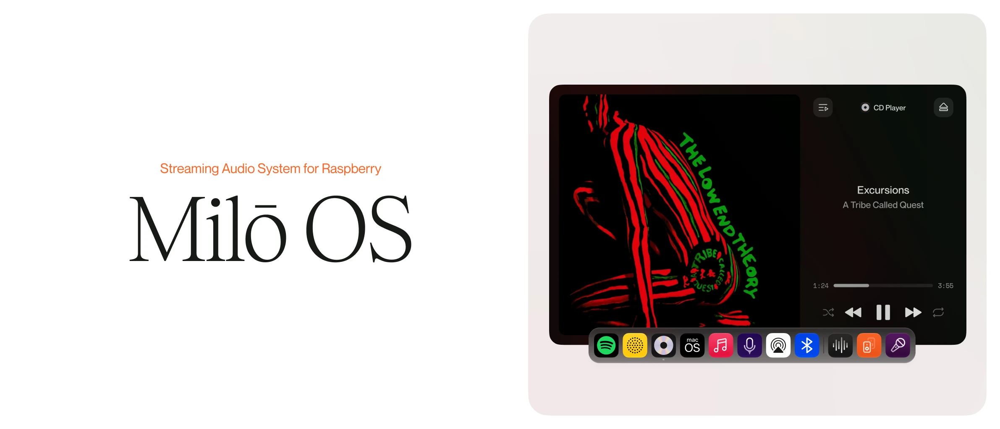
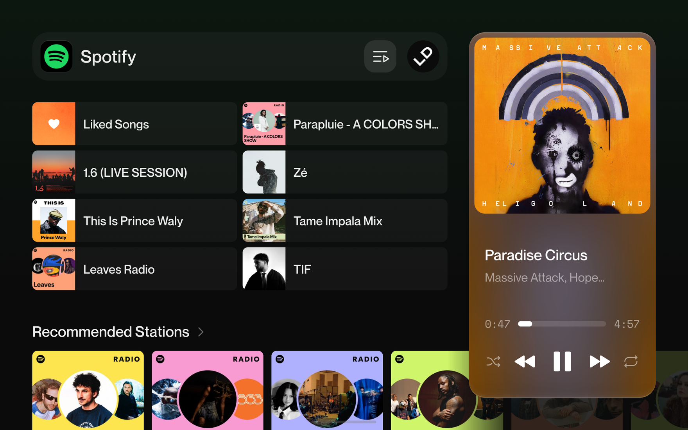
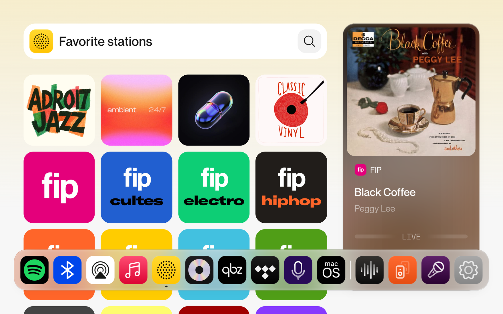
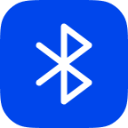
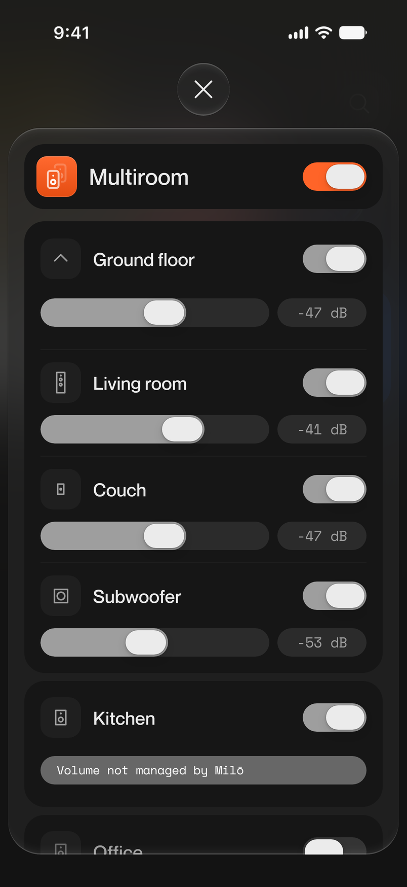
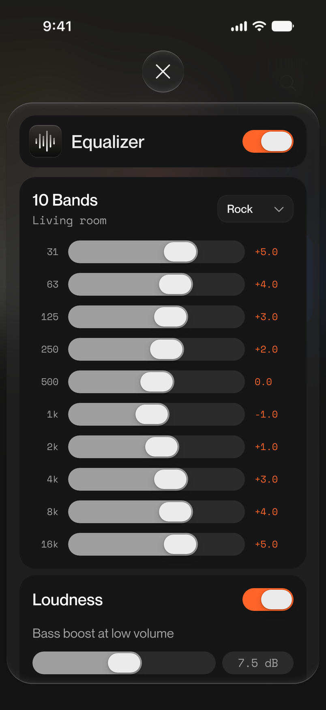
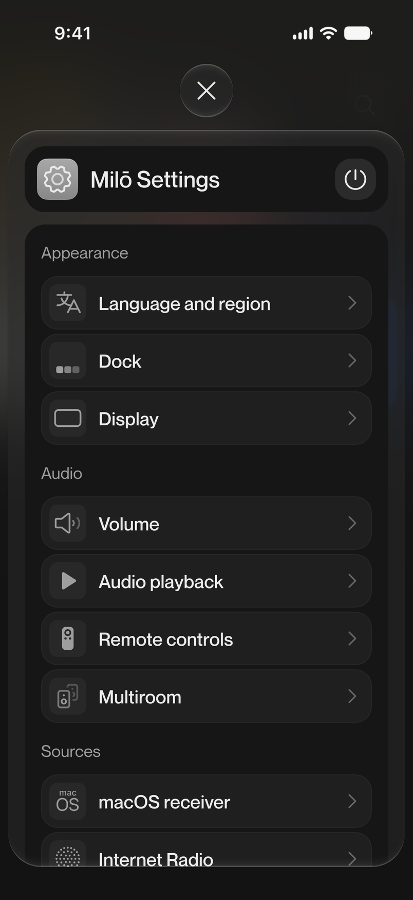
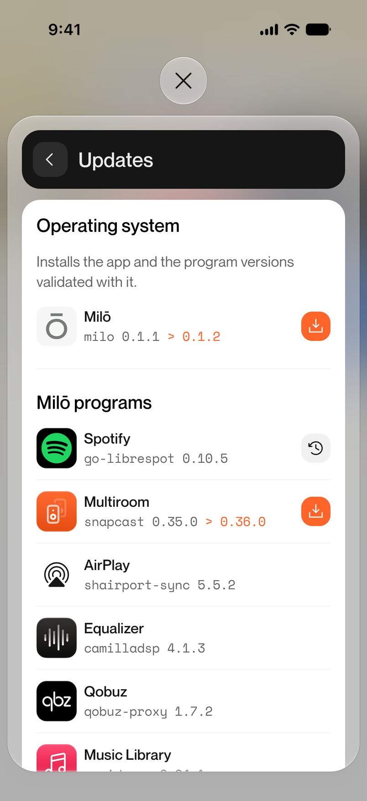

  

# Milō OS

### Turns a Raspberry Pi and an audio board into a complete music system.

Play Spotify, Qobuz, TIDAL, AirPlay, Bluetooth, internet radio, podcasts, CDs and your own
music library, all from one interface on its touchscreen, your phone and your Mac. Add a
Raspberry Pi per room and every room plays in sync, each with its own volume and equalizer.
It installs from a single image, and a setup wizard takes care of the rest, with no terminal
step.

📖 **[Documentation](https://milo-audio.com/docs)**: hardware, installation, every source and every setting.

## Audio sources

  
  

&nbsp;&nbsp;**Spotify Connect**, with your library, playlists and profiles

&nbsp;&nbsp;**Qobuz Connect**, lossless

&nbsp;&nbsp;**TIDAL Connect**

&nbsp;&nbsp;**AirPlay 2**, from an iPhone, iPad or Mac

&nbsp;&nbsp;**Bluetooth**, from any phone

&nbsp;&nbsp;**Internet radio**, 50,000+ stations, with favorites and track recognition by Shazam

&nbsp;&nbsp;**Podcasts**, search, subscribe and resume where you left off

&nbsp;&nbsp;**CD player**, with track and album lookup

&nbsp;&nbsp;**Music library**, your own files from a USB drive or a network share (SMB, NFS)

&nbsp;&nbsp;**Your Mac's sound**, with low latency, through [Milō Mac](https://github.com/leodurandfr/Milo-Mac)

## Features

  

  
  
  
  

- **Multiroom**: every room on the same song, in sync. An extra Raspberry Pi finds your Milō
  and joins it as a speaker on its own. Zones group rooms, each speaker keeps its own volume,
  and a subwoofer gets the low end automatically.
- **Equalizer**: 10 bands, 22 presets, a compressor and loudness compensation, on every
  speaker separately (CamillaDSP).
- **Lyrics**: synced line by line with the track, on Spotify, Qobuz, TIDAL, AirPlay, your
  library, a CD, or the radio once the song is recognized.
- **Light and dark themes**, or Auto, which turns dark from sunset to sunrise. The screenshots
  on this page show both.
- **Updates**: one press updates Milō and every multiroom speaker. The programs behind the
  sources (Spotify Connect, AirPlay, Qobuz Connect, the music library), multiroom and the
  equalizer update the same way, each to the version tested with Milō.
- **8 languages**: English, French, German, Spanish, Portuguese, Italian, Chinese, Hindi.

## Hardware

- **Raspberry Pi 5** (8 GB recommended) for the main unit; a Raspberry Pi 4 (2 GB) is enough
  for a multiroom speaker.
- **A HiFiBerry board**: an amplifier for passive speakers (Amp2, Amp4, Amp4 Pro, Amp100,
  Beocreate 4CA) or a DAC for an amplifier you already own (DAC2 HD, DAC2 Pro, DAC2 ADC Pro).
  With a screen, the Amp4 Pro is the only amplifier that can power it.
- **Optional**: a Waveshare touchscreen (7" USB or 8" DSI), a volume knob, an Apple Remote or a
  Bluetooth remote, a USB CD drive.

Parts list and wiring: [Required hardware](https://milo-audio.com/docs/quick-start/hardware).

## Installation

1. Download the latest `.img.xz` from [Releases](https://github.com/leodurandfr/Milo/releases).
2. Write it to a microSD card (32 GB or more) with
   [Raspberry Pi Imager](https://www.raspberrypi.com/software/) ("Use custom").
3. Insert the card and power the Raspberry Pi on.
4. Reach the setup wizard:
   - **with an Ethernet cable**, open **http://milo.local** from a phone or computer on the
     same network;
   - **without a cable**, join the open **Milō** Wi-Fi network, and the setup page opens on its
     own.
5. Follow the wizard, then Milō restarts, ready to play.

**Multiroom speakers** use the same image. Connect them with an Ethernet cable for their first
boot: that is how they find your Milō and become its speakers. Without a cable there is nothing
to search on, and the Pi sets itself up as a second main unit instead.

Step by step: [Installation](https://milo-audio.com/docs/quick-start/install) and
[First boot](https://milo-audio.com/docs/quick-start/first-boot).

## Control it from anywhere

Any phone, tablet or computer on the same network opens Milō at **http://milo.local**. Two
companion apps go further:

- **[Milō Mac](https://github.com/leodurandfr/Milo-Mac)**: sources, volume and multiroom from
  the menu bar or keyboard shortcuts, and your Mac's own sound streamed to Milō.
- **[Milō iOS](https://github.com/leodurandfr/Milo-iOS)**: Milō's interface as an iPhone app, a
  volume widget on the Home Screen, and what Milō plays on the lock screen.

## For developers

- [Architecture](docs/architecture.md): technologies and how Milō works
- [API overview](docs/api-overview.md): the REST and WebSocket surface
- [Developer guide](docs/development.md): setup, adding a source, testing
- [Wiring reference](docs/hardware/wiring.md): physical connections

Backend in Python (FastAPI, asyncio), frontend in Vue 3, audio on ALSA, CamillaDSP and Snapcast.

## License

[PolyForm Shield 1.0.0](LICENSE): source-available. Read it, run it, change it and self-host
it, at home or in your business.
